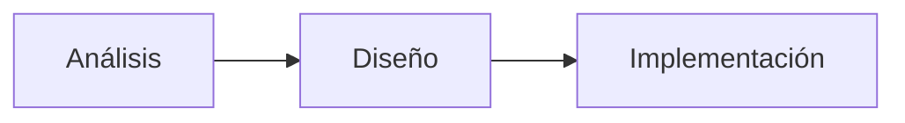

# Análisis y diseño orientado a objetos

## Análisis - AOO
*El proceso que modela el dominio del problema identificando y especificando un conjunto de objetos semánticos que interaccionan y se comportan de acuerdo a los requisitos del sistema.*

**Objetivo**: modelar la semántica del problema en términos de objetos 
distintos pero relacionados
### Actividades
1. identificación de clases semánticas, atributos y servicios
1. Identificación de las relaciones entre clases
1. emplazamiento de las clases, atributos y servicios
1. especificación del comportamiento dinámico mediante paso de mensajes

## Diseño - DOO
*El proceso que modela el dominio de la solución, lo que incluye a las clases semánticas con posibles añadidos, y las clases de interfaz, aplicación y utilidad identificadas durante el diseño.*

**Objetivo**: reexaminar las clases del dominio del problema, refinándolas, extendiéndolas y reorganizándolas, para mejorar su reutilización y tomar ventaja de la herencia

### Actividades
1. Añadir las clases interfaz, base y utilidad.
1. Refinar las clases semánticas

# Identificacion de objetos
## Analisis textual
Parte de una descripción del problema en lenguaje natural, se extraen los objetos, los atributos, los servicios y las relaciones entre los objetos mediante un análisis lingüístico del enunciado del problema 

| Parte de la oración | Componente del modelo de objetos | Ejemplo |
| :--- | :--- | :--- |
| **Nombre propio** | *Instancia* | Puzzle |
| **Nombre común** | *Clase* | Juguete |
| **Verbo acción** | *Operación* | Guardar |
| **Verbo de existencia** | *Clasificación* | Es un |
| **Verbo de posesión** | *Composición* | Tiene un |
| **Verbo afirmativo** | *Condición de invarianza* | Posee |
| **Adjetivo** | *Valor o clase (atributo)* | Inadecuado |
| **Frase adjetiva** | *Asociación, Operación* | Cliente con niños, Cliente que compró el puzzle |
| **Verbo transitivo** | *Operación* | Entrar |
| **Verbo intransitivo** | *Excepción o suceso* | Depende |

## Tarjetas CRC
**CRC**: *Class, Responsability and Collaboration*, Clases, Responsabilidades, y Colaboraciones.

Consiste en elaborar una ficha o tarjeta por cada clase en la que se anotan los siguientes datos: el nombre de la clase, la lista de sus superclases, la lista de sus subclases, responsabilidades sus sus y colaboraciones

* **responsabilidad**: servicios que proporciona la clase a 
sus clientes potenciales.
* **colaboraciones**: las peticiones que hace una clase a ciertos servidores para poder cumplir sus responsabilidades.

| **Clase:** *nombre de la clase* | (Abstracta o concreta) |
| :--- | :--- |
| **Lista de superclases** | |
| **Lista de subclases** | |
| **Responsabilidad** | **Colaboración** |
| | |
| | |

## Formas de utilización 
Las formas de utilización o casos de uso, es una forma, patrón o ejemplo concreto de utilización, un escenario que comienza con algún usuario del sistema que inicia alguna transacción o secuencia de eventos interrelacionados, se introducen en la etapa de análisis.

Consta de dos elementos principales, los actores y las formas de utilización.
* **actor 🚹**: representa cualquier elemento que intercambia información con el sistema
* **utilizacion ⬭**: representa una secuencia de transacciones en un diálogo con el sistema que se encuentran relacionadas por su comportamiento

# Referencias
García, F., Pardo, C. (s.f.).   Introducción al Análisis y Diseño Orientado a Objetos ++ Haga clic para ver más opciones [Archivo PDF]. Recuperado de https://repositorio.grial.eu/bitstream/grial/265/1/ADOO.pdf
